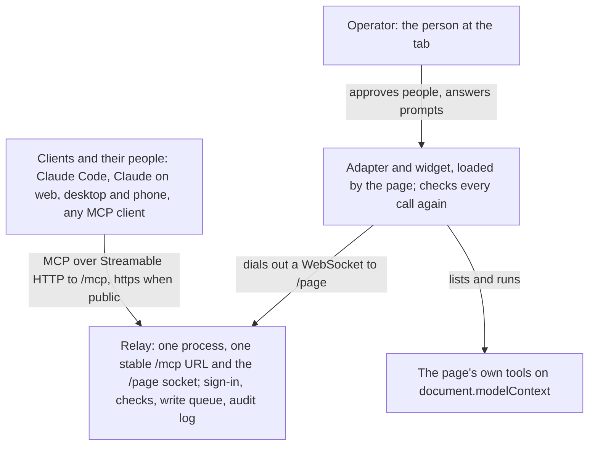
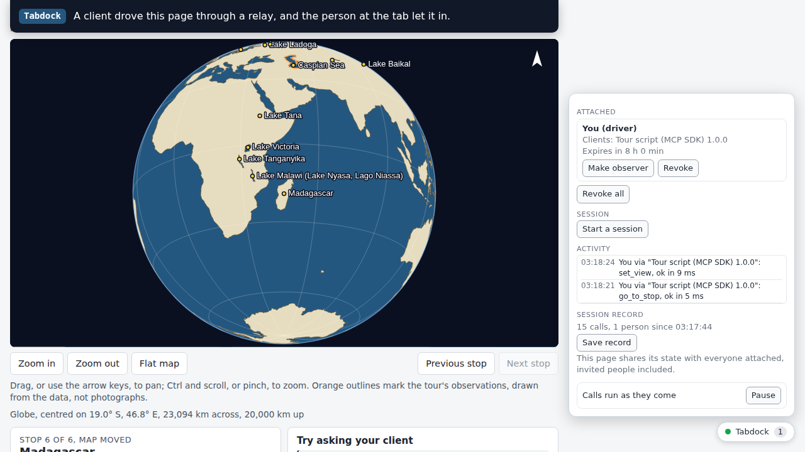

# Tabdock

Tabdock lets MCP clients use the tools of a live web page. The page registers tools through WebMCP, and a small adapter on it dials out to a relay: a remote MCP server with one stable URL that Claude Code, Claude on the web, desktop and phone, or any MCP client adds once. Several people and clients can attach to one page, and the person at the tab approves each, unless the page admits members as observers by policy or that person has minted a Can watch invite, which admits guests as observers in advance.

## Why it is different

A page's tools run inside the tab, with the user's own signed-in session and live state, so an agent can work an app that has no API, and your back end gains no endpoint or credential.

The tab dials out to one relay URL, so the browser opens no port and the connector never changes as pages come and go. Several people and their clients share a page with roles: observers call only read-only tools, drivers call the rest, and writes run one at a time. Consequential calls wait for a human, on the page or, where the page allows it, in the calling member's own client. [Use cases](docs/guide/09-use-cases.md) shows what that makes possible; [the comparison with MCP-B's local relay](docs/mcp-b-comparison.md) shows where a simpler tool fits better.

## How it works



The relay never runs a tool: it signs clients in and checks and routes each call, and the adapter checks it again before the page's handler runs. It sees calls in plain text, so you run your own. Page origins are allowlisted, tokens and codes never reach a log, and every call is audited; [Security](docs/guide/10-security.md) has the rest. [Concepts](docs/guide/01-concepts.md) explains the parts, the flows, the three dials of roles, consequence and reach, and the words for rooms, state and records.

## See it

[](https://paulmramirez.github.io/tabdock/map/)

The picture links the map demo on the project's site, live once the site is published. It is the last frame of [a recording under a minute long](apps/map-demo/media/map-demo.webm) that `pnpm record:map-demo` made: a script on the MCP SDK, standing in for Claude, pairs through a local relay, is let in as driver, and takes the tour, with the pairing code kept off camera.

The map demo draws Earth as a flat map and a globe on a plain canvas, from Natural Earth's public-domain data: connect a relay of your own, pair Claude in the widget, and ask it to take the six-stop tour, capture each stop or follow the page as you pan ([apps/map-demo](apps/map-demo/README.md)). It will live at `/map/` on the project's GitHub Pages site, beside the demo board at `/`, once the site is published by dispatching `.github/workflows/pages.yml` on `main`; the repository's website link will then point there. Until then, `pnpm dev:map-demo` serves it from a clone and prints a link for `pnpm relay`.

## For a room

Clients see nine fixed tools: `list_pages`, `pair_page`, `list_page_tools`, `call_page_tool`, `detach_page`, `get_page_state`, `wait_for_page_state`, `get_proposal` and `withdraw_proposal`. M6, which arrives in the release after 0.1.0 ([CHANGELOG.md](CHANGELOG.md)), lets one projected tab hold a class or a review. A room needs a relay with a public URL and `TABDOCK_INVITES=1`, since guests join by invite; in local mode a time-boxed session is a time box only. `pnpm demo:m6` runs a whole lesson on this machine, [the classroom explainer](docs/tour/06-classroom.md) traces it, and [Run a class](docs/guide/21-run-a-class.md#rehearse-on-one-computer) says what a rehearsal by hand needs; `pnpm dev:map` serves the canvas map page to try the map profile.

- **Map and globe pages.** A shared tool profile every client drives alike, with a canvas test page to try it on ([Map and globe pages](docs/guide/16-map-pages.md)).
- **Images and page state.** A tool the page declares returns one still PNG, JPEG or WebP, checked again by the relay and shown only behind the untrusted label; a page publishes a small JSON object any attached client reads or waits on without running a tool ([Images and page state](docs/guide/18-images-and-state.md)).
- **Proposals and time-boxed sessions.** Where a page's `policy.proposals` is `'members'` or `'all'`, an observer's write becomes a proposal the operator accepts or dismisses in the widget; under the default, `'off'`, it still answers `role_denied`. A session of 30 to 240 minutes narrows the policy and shows one QR at a time, and its end closes every live invite and agent token on the page and every attachment they made, earlier ones included ([Lessons and reviews](docs/guide/19-lessons-and-reviews.md)).
- **Session records.** The widget keeps who did what, saves it as JSON and Markdown only on the operator's click, and `pnpm audit:log --match` holds a saved record to the audit log ([The session record](docs/guide/19-lessons-and-reviews.md#the-session-record)).
- **Larger rooms and agent tokens.** 40 watching seats apart from the people limit, in a compact roster, a members file read again without a restart, and tokens with which Claude Code or a script watches one page once the operator allows it ([Larger rooms](docs/guide/20-larger-rooms.md)); a response ceiling and an optional restart snapshot ([Settings for rooms, images and state](docs/guide/14-settings-for-rooms.md)).
- **CI checks.** `pnpm ci-check` walks a map page's every stop against local mode, as CI's `ci-check` job does with no secret ([Check a page from CI](docs/guide/17-check-from-ci.md)), and another repository can copy it ([Copy the CI check](docs/guide/23-copy-the-ci-check.md)).
- **Both sides of a class.** [Run a class](docs/guide/21-run-a-class.md) takes a teacher from the relay's settings to a saved record, in order, and [Join a shared page](docs/guide/22-join-a-shared-page.md) is the other side, for a guest with a link, a watcher in a session or a program holding an agent token.

## Status

Version 0.1.0, M5's code, is prepared but not yet on npm, so today Tabdock runs from a clone; `npx @tabdock/relay` and `npm install @tabdock/adapter` work once 0.1.0 is on npm, and M6's rooms, images and state once the release after it is. Every security requirement in `SPEC.md` section 9 has automated tests. What has been checked, and where:

| Path                                                | Checked in the sandbox                                                                                                                                                                                          | Waiting for the owner's own devices                                                                                                                        |
| --------------------------------------------------- | --------------------------------------------------------------------------------------------------------------------------------------------------------------------------------------------------------------- | ---------------------------------------------------------------------------------------------------------------------------------------------------------- |
| Claude Code in local mode                           | Claude Code 2.1.289 headless, on MCP 2026-07-28 and 2025-11-25, first-class tools included                                                                                                                      | The header helper on macOS; on Windows, which shell would run one (the PowerShell `--header` line serves meanwhile); the confirmation dialog with a person |
| Other MCP clients                                   | The SDK client matrix and the official conformance suite in CI; confirmation in the client with SDK clients                                                                                                     | Nothing                                                                                                                                                    |
| The adapter in a browser                            | Headless Chromium with the MCP-B polyfill 5.1.0 and 6.0.0                                                                                                                                                       | An hour in a background tab, Energy Saver and laptop sleep                                                                                                 |
| Claude on web, desktop and phone; QR scans; invites | Public URL mode against a stand-in identity provider, in a phone-sized browser                                                                                                                                  | All of it: none has run live yet                                                                                                                           |
| The container image                                 | Built and smoke-tested                                                                                                                                                                                          | A real host                                                                                                                                                |
| M6's rooms, images, proposals and records           | The sim page, the canvas map page and the demo in headless Chromium, a stand-in provider, a measured class of 40 on a 512 MiB relay, and Claude Code 2.1.296 with images and an agent token, with no model call | Hosted Claude with images, waits and proposals; a members file and a deploy during a lesson on Fly; a real class                                           |

The open steps are in `docs/checklists/` (M3 to M6). WebMCP is an early draft in a Chrome origin trial, so the demo board uses the MCP-B polyfill.

## Quick start

You need Node 22.18 or later, pnpm 10 and Claude Code or another MCP client.

```sh
git clone https://github.com/PaulMRamirez/tabdock.git
cd tabdock
pnpm install
pnpm dev
```

With no auth settings (in the environment or `.env`) and outside production, the relay runs in local mode: loopback only, one user, and an owner token in a private file outside the checkout. On macOS and Linux `pnpm dev` prints a `claude mcp add-json` line whose header helper reads that token whenever Claude Code connects, so neither the command nor Claude Code's settings hold it. Paste it and check with `claude mcp list` (never `claude mcp get`, which prints stored headers). Open the board link it printed, click Connect, ask Claude to pair with the code in the widget, and click Allow as driver. [Quick start](docs/guide/02-quick-start.md) has the details.

## Your own page

```ts
import { attach } from '@tabdock/adapter';

const notes: string[] = [];

// A WebMCP runtime must already be installed: Chrome's own, or the MCP-B polyfill.
await document.modelContext?.registerTool({
  name: 'add_note',
  title: 'Add note',
  description: 'Add a note to the page and return how many there are.',
  inputSchema: { type: 'object', properties: { text: { type: 'string' } }, required: ['text'] },
  annotations: { readOnlyHint: false },
  execute: async (input) => {
    const text = (input as { text?: unknown } | null)?.text;
    if (typeof text !== 'string') return 'text must be a string';
    return { count: notes.push(text) };
  },
});
await document.modelContext?.registerTool({
  name: 'clear_notes',
  title: 'Clear notes',
  description: 'Remove every note. This cannot be undone.',
  inputSchema: { type: 'object', properties: {} },
  annotations: { readOnlyHint: false, consequentialHint: true },
  execute: async () => ({ removed: notes.splice(0).length }),
});

// The only control handle: keep it private.
const dock = attach({
  relay: 'ws://127.0.0.1:8787/page',
  policy: { consequentialTools: ['clear_notes'] },
});
```

That URL serves a page on the relay's own machine, and by default the relay admits http and https pages on `localhost`, `127.0.0.1` and `[::1]`; only hosted mode takes `wss://<host>/page` from pages elsewhere, on origins it lists. TypeScript knows no `document.modelContext`, so the snippet needs the short declaration in [Add to your app](docs/guide/03-add-to-your-app.md#a-webmcp-runtime).

A tool prompts the operator when its `consequentialHint` is true or `policy.consequentialTools` names it. Set both: MCP-B 5.x and Chrome 153 drop the hint, and there, on a page whose tools carry annotations, a list that names no tool makes every tool that is not read-only prompt (ADRs 0002 and 0034). A page that wants no prompts says `consequential: 'allow'`. Until 0.1.0 is on npm, take the adapter from a clone: `pnpm release:pack` packs installable tarballs into `dist/packages`, labelled 0.1.0 but built from the clone's checkout, and `pnpm --filter @tabdock/adapter build` writes the script-tag file. [Add to your app](docs/guide/03-add-to-your-app.md) has the rest.

## Claude on the web, desktop and phone

Hosted Claude reaches a connector from the cloud, so a relay on loopback cannot serve it. Public URL mode puts the relay behind a tunnel with a fixed https name and signs people in through an OAuth provider that meets `SPEC.md` section 7, plus a confidential client for the QR page at `/pair`; `pnpm dev:public` names the six settings. Pages then still attach only from the relay's machine; hosted mode, behind a host edge, takes them from anywhere on listed origins. In Claude, add `https://<relay>/mcp` under Customize, Connectors, +, Add custom connector and sign in; Claude Code uses `claude mcp add --transport http --scope user tabdock https://<relay>/mcp`, then `claude mcp login tabdock`. See [Connect clients](docs/guide/05-connect-clients.md) and [Run a relay](docs/guide/07-run-a-relay.md).

## Docs

[The guide](docs/guide/README.md) is for people using Tabdock; its [Where to start](docs/guide/README.md#where-to-start) table gives a reading order for each task, from a first look to running a class.

For contributors: `docs/develop.md` (every command), `SPEC.md` (the source of truth), `docs/adr/` (the decisions), `docs/threat-model.md` (each boundary and its tests), `docs/mcp-b-comparison.md`, `docs/tour/` (the build's history, a milestone a page), `docs/deploy.md` (the reference deployment), `docs/release.md`, `CHANGELOG.md`, `.env.example` (every setting), and the READMEs of `packages/adapter`, `packages/relay`, `packages/protocol`, `packages/sim-page`, `apps/demo`, `apps/map-demo`, `apps/site`, `tests/e2e`, `tests/map-page`, `tests/ci-check` and `tests/mcpb6`. `pnpm site:build` builds the demo board, the map demo, the tour and the guide into a static site for GitHub Pages, not yet published; until it is, run the board with `pnpm dev` and the map demo with `pnpm dev:map-demo`.

## Licence

Apache-2.0; see [LICENSE](LICENSE) and [NOTICE](NOTICE).
