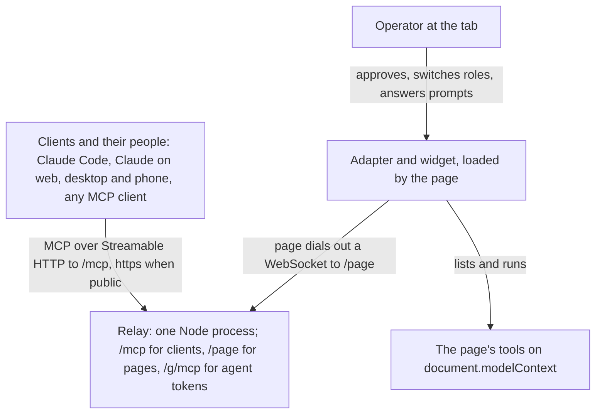
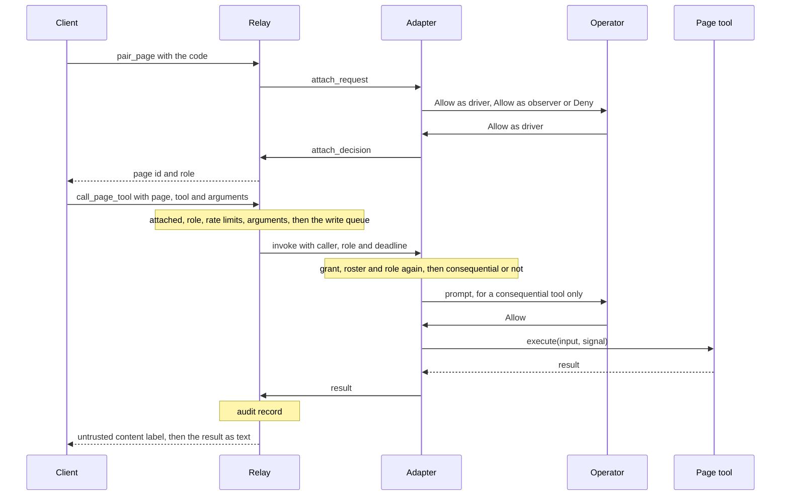
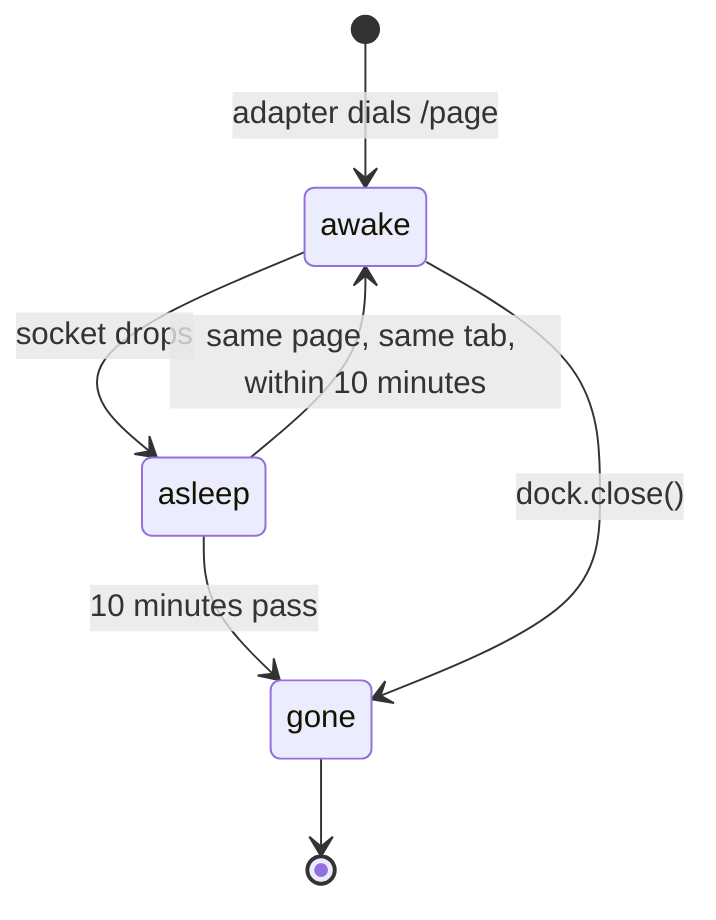

# Concepts

Tabdock turns a live browser tab into an MCP server that dials out: the page registers tools through WebMCP, an adapter in it opens a WebSocket to a relay, and the relay is a remote MCP server whose one stable URL clients add once.

## The five parts

The **page** is any web app registering tools on `document.modelContext`, through Chrome's WebMCP or the MCP-B polyfill; handlers run only in the tab, with its state and the user's session.

The **operator** is whoever sits at that tab, the root of trust: nobody attaches without the operator's approval or the page's policy, and the operator can switch roles, revoke, pause or mint invites.

The **adapter** (`@tabdock/adapter`) is a script the page loads. It reads the tools, dials the relay, checks each call again against its grants and the policy, and draws the **widget**: pairing code and QR code, roster with a Watching section, prompts, proposal queue (Accept, Dismiss, Dismiss all), activity, Pause, invites and agent tokens, session block (Start a session, Show QR, New link, Extend 15 min, End session) and record box (Save record). Only code that called `attach()` holds the control handle.

The **relay** (`@tabdock/relay`) is one Node process with three doors: `/mcp`, the URL clients add; `/page`, the socket pages dial; and `/g/mcp` for agent tokens, while `TABDOCK_AGENT_TOKENS` is on. It signs clients in, keeps pages, attachments, codes, invites, published state, proposals, sessions and agent tokens in memory, and checks and routes calls. It runs no tool, but it and any tunnel or host edge ending TLS before it see calls and results in plain text, so run your own.

The **clients** are Claude Code, Claude on the web, desktop and phone, or any MCP client; identity is the signed-in account. A **member** is an account the relay knows: local mode's `you`, a dev token's user, or an entry in `TABDOCK_OAUTH_USERS` or the **members file** `TABDOCK_MEMBERS_FILE`, reread within about 4 s. With invites on (`TABDOCK_INVITES=1`) any other signed-in account is an **invitee**, reaching a page only by invite; with invites off, the relay refuses it.

## Four flows

**Dial out.** The adapter connects to `/page`. The relay checks the page's origin, from the browser's `Origin` header, never page text, against its allowlist, and answers with a page id such as `pg_0123456789` and a **pairing code** such as `ABCDE-12345`, which lives 120 s and works once.

**Attach.** An **attachment** joins one account to one page with a role. A member's client calls `pair_page` with the code, or a phone scans the QR code and signs in at `/pair`; the operator answers Allow as driver, Allow as observer or Deny within 60 s, and silence denies. A guest redeems an **invite** link minted in the widget: Can watch admits an observer unasked, Can control prompts. An invite's or agent token's **sponsor**, the member attached longest at minting, takes all it sponsored along when its attachment ends.

**Call.** Every relay offers nine **fixed tools**: `list_pages`, `pair_page`, `list_page_tools`, `call_page_tool`, `detach_page`, `get_page_state`, `wait_for_page_state`, `get_proposal` and `withdraw_proposal`. With `TABDOCK_FIRST_CLASS_TOOLS=1` a member's client also lists attached pages' tools as **first-class tools**, `<page id>__<tool>`, which take `call_page_tool`'s path.

Writes run one at a time per page in arrival order, reads alongside, each under the least of the adapter's grant, the relay's roster and the claimed role. The result reaches the client within 45 s as text under a `[tabdock: untrusted content from <origin>, tool <name>]` line, so the model treats it as data. The widget's activity log and the relay's hash-chained **audit log** record each call.

An **image tool**, named in `policy.imageTools`, may return one still PNG, JPEG or WebP, checked by adapter and relay alike; the client gets one text block (the label, a relay line calling the image untrusted, the page's text), then the image. **Page state** is one JSON object of at most 16,384 bytes, published with `dock.publishState()` or, from a script tag, a `tabdock:state` event on `document`; clients read it, or wait for a newer version, behind its label without running a page tool. A **profile**, such as `tabdock.map.v1`, is a convention among pages for tool names and shapes, unread by relay and adapter.

**Lifecycle.**

When the socket drops (a reload, a closed tab, a lost network) the page sleeps, and its attachments wait 10 minutes for it to return in the same tab ([one page](04-adapter-reference.md#what-counts-as-one-page)). Attachments end after 8 hours unused; those an invite or agent token made end within 24 hours, or with the page session, a time-boxed session or their sponsor's attachment, and an agent token's with the token.

A relay restart forgets pages, attachments, codes and invites, unless the **restart snapshot** (`TABDOCK_RESTART_SNAPSHOT`, off by default, needing an audit directory) carries pages under the same ids, attachments, invites, agent tokens and sessions across a graceful stop of under 10 minutes; never codes, pending requests, proposals or published state. Page ids, and first-class names built on them, change with a new tab, a crash or a restart without it: never hard-code them.

## Three dials

**Roles.** An **observer** may call only tools whose `readOnlyHint` is true; every other tool is a write. A **driver** may call every tool. The operator picks the role and can switch it. `maxDrivers` (default 1) counts people, not clients, and seats a driver past it as an observer. A page holds 10 people by default, at most 50, and watchers apart.

**Consequence.** A tool is **consequential** when its `consequentialHint` is true or the page names it in `policy.consequentialTools`; name it in both, as MCP-B 5.x and Chrome 153 drop the hint, and there a page naming none treats every write as consequential. The `consequential` policy prompts (`'confirm'`, the default), runs (`'allow'`) or refuses (`'deny'`). Under `'confirm'`, `confirmVia: 'client'` turns on **confirmation in the client** for member drivers no invite let in, whose yes proves only that their client answered.

| Caller                                                        | Read-only tool | Write                          | Consequential write                                                          |
| ------------------------------------------------------------- | -------------- | ------------------------------ | ---------------------------------------------------------------------------- |
| Observer                                                      | Runs           | `role_denied`                  | `role_denied`                                                                |
| Observer whom `proposals` admits                              | Runs           | `proposed`; runs once accepted | `proposed`; Accept confirms it; under `'deny'`, `denied_by_operator` at once |
| Driver, `'confirm'`                                           | Runs           | Runs, one write at a time      | Prompts on the page; Deny or silence: `denied_by_operator`                   |
| Member driver, no invite, `confirmVia: 'client'`, elicitation | Runs           | Runs, one write at a time      | Confirms in the client; anything but yes: `not_confirmed`                    |
| Driver, `'allow'`                                             | Runs           | Runs, one write at a time      | Runs with no prompt                                                          |
| Driver, `'deny'`                                              | Runs           | Runs, one write at a time      | `denied_by_operator`                                                         |

A paused page answers `page_busy` to every call not yet running, queued or prompting.

**Reach.** **Local mode**, the default outside production, serves one user on the relay's machine, and dev tokens (`TABDOCK_DEV_TOKENS`) several, for testing. **Public URL mode** adds sign-in through a tunnel, for hosted Claude, QR codes and invites; pages still attach only locally. **Hosted mode** takes pages from anywhere. [Run a relay](07-run-a-relay.md) compares them.

## Rooms, state and records

A **proposal** is an observer's write where `policy.proposals` admits the caller (`'members'` for members, `'all'` for invitees too, never an agent token): it answers `proposed` with an id and runs only once accepted, Accept being its confirmation.

A **watcher** is an invitee watching by invite, agent tokens included; with invites on, they take **watching seats**, 40 a page by default and at most 100, and share 60 calls a minute to the page.

A **time-boxed session** lasts 30 to 240 whole minutes, narrows driver seats and proposals within the policy and mints one watch link per 20 observers; its end closes the page's live invites and agent tokens and what they let in. In local mode it is a time box only.

An **agent token** is a bearer credential for one page, used at `/g/mcp`: its first request raises an ordinary prompt; it is observer only, never proposes and lasts at most 8 hours.

The **session record** is the widget's in-memory record of who attached and each call that reached the page, never arguments or results, saved only on the operator's click and held to the audit log by `audit --match`.

[Settings for rooms](14-settings-for-rooms.md#members-agents-and-restarts) gives the members file's and snapshot's rules, [Larger rooms](20-larger-rooms.md#the-members-file) a class's use.

## What makes it unusual

Most MCP servers wrap an API; Tabdock wraps the page, so agents use the code people click and no credential leaves the browser. Every check runs twice, so a rogue relay cannot pass the operator's approval. Nothing is encrypted end to end.

Next: [Quick start](02-quick-start.md).
