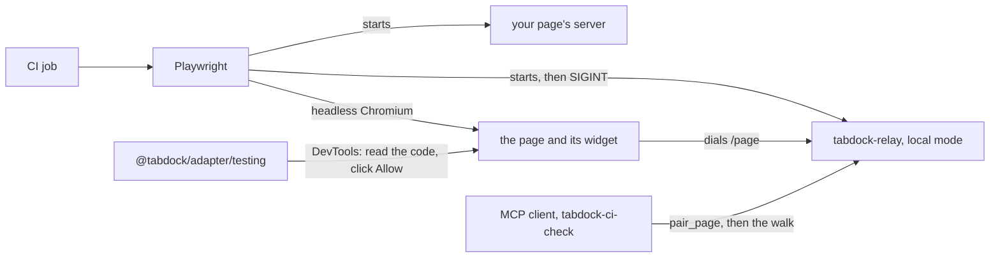

# Check a page from CI

A walkthrough is content, and content breaks: a stop's view moves, a photo's viewpoint drifts, a layer is renamed. This page describes a check that walks every stop of a map page (page 16) on every change, with no secret and no person at the tab. It runs the relay in local mode on the CI runner, which is one machine, so the owner token never leaves it (ADR 0041). It does not reach a public relay: that needs an interactive sign-in, so an unattended driver there is still not supported.

## What the check needs

The walk needs four of the profile's tools, each listed to a driver: `get_view` and the whole walkthroughs group, `list_walkthroughs`, `get_stop` and `go_to_stop`. Without them it fails at once with one `tools` finding for each, `not listed`, and walks nothing. It never calls `set_view`. The page must also publish `MapPageState` ([Images and page state](18-images-and-state.md#share-what-the-page-shows)), since every stop waits until the state names it, and hold at least one walkthrough with a stop: a page with none passes having checked nothing.

`REQUIRE_TOOLS` in `specs/walk.spec.ts` covers only the optional groups the walk checks where the page lists them: the clock (`get_clock`), capture (`capture_view`) and observations (`list_observations`, `get_observation`, `view_from_observation`). It passes them to `walkPage()` as `requireTools`, so a page that stops registering one fails the walk instead of skipping its checks. Layers and features are never walked.

## What runs

Playwright starts the relay and your page's server, opens the page and links it to the relay. The testing helper reads the pairing code from the widget's closed shadow root through the DevTools protocol, and once the client has called `pair_page` it clicks Allow as driver with trusted input, after the widget's half second of arming, as a person would. It refuses to choose when two waiting requests carry the client's name. Then the client walks the page, and a last step verifies the relay's audit chain.

`tests/ci-check/playwright.config.ts` starts the relay with readiness on `/healthz`, which needs no token, and stops it with SIGINT, so it writes `relay_stop` to its audit log. It never reuses a server already on a port, which could hold another token.

## Run it

From a clone, `pnpm ci-check` runs the example in `tests/ci-check` against the canvas map page, as CI's `ci-check` job does. [Copy the CI check](23-copy-the-ci-check.md) sets it up in another repository: the files to copy, the install before and after the release, the four things to change and the workflow job.

## What the walk checks

The walk, `walkPage()` in `tests/ci-check/src/walk.ts`, first checks that `list_pages` shows the page with the role driver. For every stop it calls `go_to_stop`, `get_stop`, `get_view` and `get_clock`: the view must match the stop's, angles within 1e-6 degrees and metres within a relative 1e-6, and a paused clock its time. It reads the state the page publishes with `get_page_state`, waits with `wait_for_page_state` until the state names the stop, and holds its view and clock to what the tools said. `capture_view`, asked for `{ format: 'png' }`, must return one PNG within the relay's image cap, 65,536 bytes by default ([Images and page state](18-images-and-state.md#return-an-image)). For every observation, `view_from_observation` must land on its viewpoint and the state must follow.

Every result is read from after the relay's label, with copies of the profile's schemas in `tests/ci-check/src/profile.ts`, and a result with no label is a finding. Findings hold ids and numbers only, never page text, and one bad stop never hides the rest. The spec prints `ci-check: <n> page calls`. Only this repository's runner, `scripts/ci-check.ts`, then matches that many call records, every one ok, from `you` through `tabdock-ci-check`, and scans its output for the token or an unmasked pairing code; a copy's workflow verifies the chain alone.

A write that raises a prompt fails at once with "the page prompts for a write; set consequential or consequentialTools (ADR 0034)", since nobody in CI answers it. A page that names no consequential tools fails so on its first write wherever the runtime drops `consequentialHint`, as MCP-B 5.1 does.

## Pacing, and when to split

The walk takes at most 100 page calls and 200 requests a minute, under the relay's defaults, so the check never needs a limit raised. A stop costs five page calls and about seven requests, so a runner walks about 20 stops a minute. Once a walk passes 10 minutes, split it into one test per walkthrough and shard it across runners, each with its own relay; more workers on one runner only share one user's budgets.

## A page that answers its own prompts

A page can attach with `ui: false` and answer prompts through its own handle (page 13). The example does not, and a test build that does must never ship: a page that approves itself is the setting ADR 0041 rejected. The helper tests the page unchanged, through the same click a person makes.

## The advisory walk

`pnpm ci-check --advisory` runs headless Claude Code against the same setup: it looks at each stop's picture and gives a verdict, and gates nothing. It never runs in this repository's CI. In a copy, `npx playwright test --config tests/ci-check/playwright.config.ts --project advisory` runs it on Linux or macOS, where local mode writes the `claude-headers` helper it connects with, with `claude` on the PATH and signed in or `ANTHROPIC_API_KEY` set; without `claude` the spec skips. Give it a job of its own with `continue-on-error`, the key on its one step, and a condition that keeps it off pull requests from forks; never use `pull_request_target`.

The model reads untrusted page text and images, so Claude Code is held to the relay's tools. `--tools ""` removes every built-in tool, so it has no shell and no files, and `--strict-mcp-config` drops every other server, which leaves it the relay's nine; `--allowedTools` names the four a walk calls, `list_pages`, `list_page_tools`, `call_page_tool` and `get_page_state`, and `--permission-mode dontAsk` denies the rest.

`--setting-sources project`, from an empty scratch directory, leaves out your own settings files with their allow rules, hooks and plugins, while your sign-in still works, and `--max-turns` bounds the run. The spec stops the run at once if Claude Code's init event lists a tool or server outside the relay's, lacks one of the four, or names a permission mode other than dontAsk, and ends it when the test ends. Its token comes from local mode's `claude-headers`.

## Windows

The check covers Linux and macOS runners. Windows waits on the owner's run of local mode there: `RUNNER_TEMP` lies outside the folders local mode accepts on Windows, and Playwright cannot stop the relay gracefully there, so it would end without `relay_stop`.

The check pairs through `@tabdock/adapter/testing`, whose calls [Scripts and the widget](24-scripts-and-the-widget.md#the-testing-helper) lists.

Next: [Images and page state](18-images-and-state.md).
