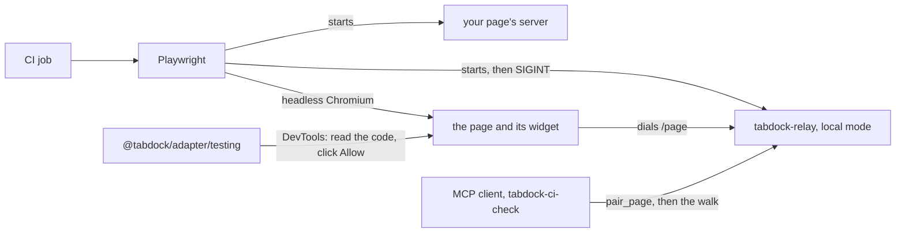

# Check a page from CI

A walkthrough is content, and content breaks: a stop's view moves, a photo's viewpoint drifts, a layer is renamed. This page sets up a check that walks every stop of a map page (page 16) on every change, with no secret and no person at the tab. It runs the relay in local mode on the CI runner, which is one machine, so the owner token never leaves it (ADR 0041). It does not reach a public relay: that needs an interactive sign-in, so an unattended driver there is still not supported.

## What runs



Playwright starts the relay and your page's server, opens the page and links it to the relay. The testing helper reads the pairing code from the widget's closed shadow root through the DevTools protocol, and once the client has called `pair_page` it clicks Allow as driver with trusted input, after the widget's half second of arming, as a person would. It refuses to choose when two waiting requests carry the client's name. Then the client walks the page, and the job checks the audit log.

## Set it up

From a clone, `pnpm ci-check` runs the example in `tests/ci-check` against the canvas map page. In your own repository, once 0.1.0 is on npm, install what it needs:

```sh
npm install --save-dev --save-exact @tabdock/relay@0.1.0 @tabdock/adapter@0.1.0 @playwright/test@1.56.1 @modelcontextprotocol/client@2.3.1 zod@4.6.5
```

Copy the `tests/ci-check` directory and change three things: `connectPage()` in `tests/ci-check/src/tabdock.ts`, the command that serves your page (`CI_CHECK_PAGE_COMMAND`) and its address on loopback (`CI_CHECK_PAGE_URL`). The canvas page links when its own script asks, never from its URL, so the fixture calls that script:

```ts
import type { Page } from '@playwright/test';

/** Links the page to the relay through the page's own script, never its URL. */
export async function connectPage(page: Page, relayPageUrl: string): Promise<void> {
  const linked = await page.evaluate((relay) => {
    const hook = (window as { __tabdockMapPage?: { connect(relayUrl: string): boolean } })
      .__tabdockMapPage;
    return hook?.connect(relay) ?? false;
  }, relayPageUrl);
  if (!linked) throw new Error('the page did not link to the relay');
}
```

`tests/ci-check/playwright.config.ts` starts both servers, the relay with readiness on `/healthz`, which needs no token, and SIGINT to stop it, so it writes `relay_stop` to its audit log. It never reuses a server already on a port, which could hold another token.

## The workflow job

```yaml
ci-check:
  runs-on: ubuntu-24.04
  timeout-minutes: 15
  permissions:
    contents: read
  steps:
    - uses: actions/checkout@<commit SHA> # pin by SHA
      with:
        persist-credentials: false
    - uses: actions/setup-node@<commit SHA> # pin by SHA
      with:
        node-version: 22
    - run: npm ci
    - run: npx playwright install --with-deps chromium
    - name: A fresh TABDOCK_HOME under the runner's temporary directory
      run: echo "TABDOCK_HOME=$RUNNER_TEMP/tabdock-ci-check" >> "$GITHUB_ENV"
    - run: npx playwright test --config tests/ci-check/playwright.config.ts --project chromium
      env:
        CI_CHECK_PAGE_COMMAND: npm run serve -- --port 5180
        CI_CHECK_PAGE_URL: http://127.0.0.1:5180/
    - name: Delete TABDOCK_HOME
      if: always()
      run: rm -rf -- "${TABDOCK_HOME:?}"
```

`TABDOCK_HOME` holds the owner token and the audit log. It must be a fresh absolute directory outside every repository, whose every parent only the runner account or root can write, and never under `/tmp`, which local mode refuses. A job's `env` cannot read the runner context, so a step writes it to `$GITHUB_ENV`, and the last step deletes it whatever happened. Never cache or upload it; to keep a record, keep the output of `npx tabdock-relay audit --json`, which holds no token, code or argument. Set no other relay setting: local mode's defaults are what make the check safe.

On a self-hosted runner, follow the same steps under its own `RUNNER_TEMP`, with one runner account per machine, since local mode trusts every account on it. Give each runner on one machine its own `TABDOCK_PORT`. Playwright drives Chromium over a pipe, so no other process gets a DevTools port to click Allow with; never add `--remote-debugging-port` on a shared machine.

## What the walk checks

The walk, `walkPage()` in `tests/ci-check/src/walk.ts`, first checks that `list_pages` shows the page with the role driver. For every stop it calls `go_to_stop`, `get_stop`, `get_view` and `get_clock`: the view must match the stop's, angles within 1e-6 degrees and metres within a relative 1e-6, and a paused clock its time. It reads the state the page publishes with `get_page_state`, waits with `wait_for_page_state` until the state names the stop, and holds its view and clock to what the tools said. `capture_view` must return one PNG within the image cap. For every observation, `view_from_observation` must land on its viewpoint and the state must follow.

Every result is read from after the relay's label, with copies of the profile's schemas in `tests/ci-check/src/profile.ts`, and a result with no label is a finding. Findings hold ids and numbers only, never page text, and one bad stop never hides the rest. The spec prints `ci-check: <n> page calls`, and this repository's runner then verifies the audit chain and requires that many call records, every one ok, from `you` through `tabdock-ci-check`. It fails if its output holds the token or an unmasked pairing code.

## Pacing, and when to split

The walk takes at most 100 page calls and 200 requests a minute, under the relay's defaults, so the check never needs a limit raised. A stop costs five page calls and about seven requests, so a runner walks about 20 stops a minute. Once a walk passes 10 minutes, split it into one test per walkthrough and shard it across runners, each with its own relay; more workers on one runner only share one user's budgets.

## A page that answers its own prompts

A page can attach with `ui: false` and answer prompts through its own handle (page 13). The example does not, and a test build that does must never ship: a page that approves itself is the setting ADR 0041 rejected. The helper tests the page unchanged, through the same click a person makes.

## The advisory walk

`pnpm ci-check --advisory` runs headless Claude Code against the same setup: it looks at each stop's picture and gives a verdict, and gates nothing. It never runs in this repository's CI. In a repository of your own, give it a job of its own with `continue-on-error`, `ANTHROPIC_API_KEY` set on its one step, and a condition that keeps it off pull requests from forks; never use `pull_request_target`.

The model reads untrusted page text and images, so Claude Code gets the four Tabdock tools a walk needs and nothing else. `--tools ""` removes every built-in tool, so it has no shell and no files; `--strict-mcp-config` drops every other server; `--setting-sources project`, from an empty scratch directory, leaves out your own settings files with their allow rules, hooks and plugins, while your sign-in still works; and `--permission-mode dontAsk` denies whatever `--allowedTools` does not name. `--max-turns` bounds the run. The spec stops the run at once if Claude Code's init event lists any other tool, and ends it when the test ends. Its token comes from local mode's `claude-headers`.

## Windows

The check covers Linux and macOS runners. Windows waits on the owner's run of local mode there: `RUNNER_TEMP` lies outside the folders local mode accepts on Windows, and Playwright cannot stop the relay gracefully there, so it would end without `relay_stop`.

## The testing helper

`@tabdock/adapter/testing` ships in the adapter's package and takes any DevTools session through a structural `DevToolsSession` type, so Playwright is not a dependency. It never logs, and no error it throws quotes what it read.

| Export              | What it does                                                                                    |
| ------------------- | ----------------------------------------------------------------------------------------------- |
| `readPairingCode()` | Waits for the widget to show a pairing code and returns it; never print it                      |
| `allowAttach()`     | Clicks Allow as driver or observer on the one request with this client name or id               |
| `clickInWidget()`   | Clicks a widget button by its action once it is armed and a hit test reaches it                 |
| `widgetButton()`    | Waits until a button is armed and uncovered, and returns its centre                             |
| `widgetText()`      | Reads the text of a widget node by its role                                                     |
| `waitingPrompts()`  | Lists waiting attach requests and confirmations, so a walk fails fast on a prompt it cannot see |
| `maskCode()`        | Hides a pairing code's second half for narration                                                |
| `WidgetTestError`   | What the helper throws: counts, actions and timeouts, never text it read                        |
| `HOST_TAG`          | The widget's element name, `tabdock-dock`                                                       |
| `WIDGET_ACTIONS`    | Every button action the widget has                                                              |
| `WIDGET_ROLES`      | Every node role the widget has                                                                  |

Back to [the guide's index](README.md).
