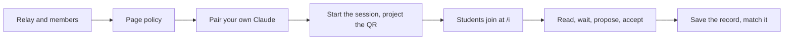

# Run a class

This page walks one lesson on one projected tab in order, from the relay's settings to a saved record matched against the audit log. Each step links the page that holds its rules and numbers; this one restates none of them.

**Status: not yet run live with a class.** `pnpm demo:m6` rehearses every step on one machine against a stand-in provider: a members file changed with no restart, a session ending on the page's clock, forty watchers on two watch links, a student's proposal accepted in the widget, a restart from the snapshot and the record held to the log. `pnpm measure:room` sized a 512 MiB relay for classes of 40 and 80 ([Larger rooms](20-larger-rooms.md#sizing-a-class-relay)). Whether hosted Claude's model reads a page's pictures, and how long a stop takes on the reference host, wait on the owner's run.



## Before term

Run a relay at a public URL, through a tunnel or on a host ([Run a relay](07-run-a-relay.md), [deploy.md](../deploy.md)), with `TABDOCK_INVITES=1`, an audit directory in `TABDOCK_AUDIT_DIR` and `TABDOCK_AUDIT_RETENTION_DAYS=7`. Add `TABDOCK_RESTART_SNAPSHOT=1` if you may deploy during a lesson, and for a class over 40 raise the watching seats and the invitee pool as [Settings for rooms](14-settings-for-rooms.md#seats-on-a-page) says.

List yourself, co-teachers and assistants in the members file: members pair by code and sponsor guests, while students join by link and are never listed ([Larger rooms](20-larger-rooms.md#the-members-file)).

## The page

Give the page a policy that takes watch invites and proposals from everyone, declares its image tool, and names its irreversible tools, here `reset_edits`, since MCP-B 5.1 drops `consequentialHint` and a page naming none prompts for every write; a page with none sets `consequential: 'allow'` instead ([Adapter reference](04-adapter-reference.md#the-policy)).

```ts
import { attach } from '@tabdock/adapter';

attach({
  relay: 'wss://relay.example/page',
  policy: {
    invites: 'watch',
    proposals: 'all',
    imageTools: ['capture_view'],
    consequentialTools: ['reset_edits'],
  },
});
```

## Before class

Add the relay's connector to your own Claude and pair it with the widget's code as a member, before anyone else ([Connect clients](05-connect-clients.md), [Sharing](06-sharing.md#approve-and-choose-a-role)). Your attachment sponsors the session's watch links, so it must not end or idle out before the lesson does, or every student leaves with it; the session block warns when it may.

A few minutes early, choose Start a session: a label, the length, one driver seat, the observers you expect and proposals from all ([Lessons and reviews](19-lessons-and-reviews.md#time-boxed-sessions)). The form names you as the sponsor before Start. Project Show QR, which shows the first watch link with uses left, and tell the room the widget keeps a record of who joined and every call. Links show once, so after a reload the widget offers New link, which closes the earlier links: anyone holding an old one needs the new one.

## Students join

Students open the link in their phone's browser, never in Claude, sign in at `/i` and tap Join, then add the connector `/i` shows in Claude on the web or the desktop app with the same account ([Join a shared page](22-join-a-shared-page.md)). Near the start some meet `rate_limited`, since a page takes pairings at a fixed rate and a hosted relay limits sign-ins from one address; they tap Join again a minute later ([Larger rooms](20-larger-rooms.md#a-class-joining)).

## During class

Each student's Claude reads the view with `get_page_state`, follows it with `wait_for_page_state`, looks with `capture_view` and proposes stops. You accept the good ones in the widget; Accept is that call's confirmation, so no second prompt follows ([Lessons and reviews](19-lessons-and-reviews.md#proposals)). Watchers share a few calls a minute to the projected tab, and state reads spend none of them, so steer the room to state ([Limits for rooms](15-limits-for-rooms.md)). Extend adds time; End session asks first.

## A deploy mid-lesson

With the snapshot on, a graceful deploy that starts again within 10 minutes keeps pages, attachments, invites, the session and agent tokens. It drops pending proposals and their waits, attach requests, pairing codes and sign-ins in progress, and students see `page_asleep` until the tab reconnects. A deploy that also lowers the seats or drops the page's origin refuses the snapshot whole, and everyone pairs again ([Settings for rooms](14-settings-for-rooms.md#members-agents-and-restarts)).

## After class

When the session ends the widget offers its record; choose Save JSON. Copy the audit files for the lesson's days off the host ([deploy.md](../deploy.md#reading-the-audit-log)) and run, on your own computer:

```sh
pnpm audit:log --dir <dir> --match <file> --verify
```

Its last line reads `match: agrees with the log` when the record and the log agree call by call; give `--dir` every file the lesson spans ([Lessons and reviews](19-lessons-and-reviews.md#the-session-record)).

Next: [Join a shared page](22-join-a-shared-page.md).
