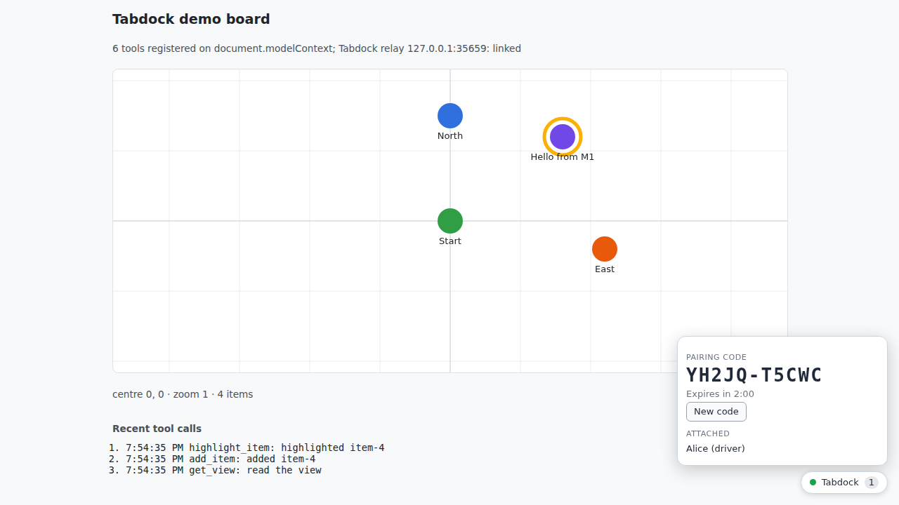
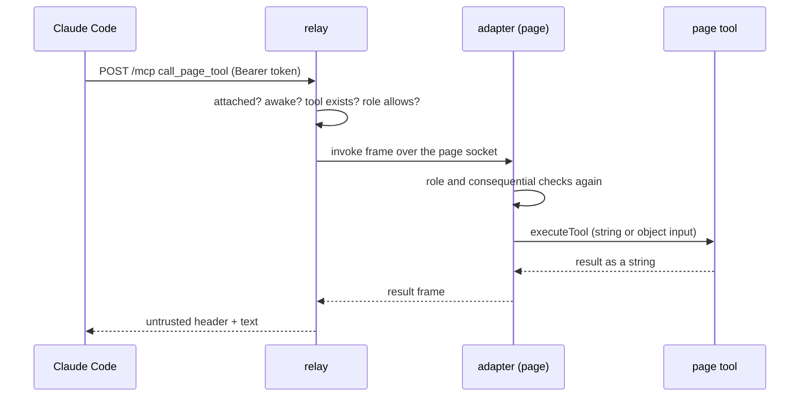

# 01: The walking skeleton

M1 is the first time Tabdock itself carries a call: a page dials the relay and shows a code, a client pairs with it, the person at the tab approves, and the client calls the page's tools, all on one machine with dev tokens.

## What exists now

`packages/protocol` defines every frame between page and relay as a zod schema, with the shared limits. `packages/relay` is one Node process: [relay.ts](../../packages/relay/src/relay.ts) checks each page socket's `Origin` and serves `/mcp` through the official SDK; [hub.ts](../../packages/relay/src/hub.ts) owns page sessions, pairing codes, attachments and calls; [mcp.ts](../../packages/relay/src/mcp.ts) defines the fixed tools, five then and nine since M6; [auth.ts](../../packages/relay/src/auth.ts) holds the dev-token plugin. `packages/adapter` is the page side: [core.ts](../../packages/adapter/src/core.ts) holds all the behaviour with no DOM, [widget.ts](../../packages/adapter/src/widget.ts) draws the badge and prompts in a closed shadow root, and `attach()` in [index.ts](../../packages/adapter/src/index.ts) returns the only control handle. `packages/sim-page` runs the same core in Node against a fake WebMCP that behaves like the polyfill or Chrome 154 or 156, and since M6 like MCP-B 6.0.0 too (the `mcpb-6` profile); most tests use it.

## One call, traced

Pairing came first: the widget showed `XXXXX-XXXXX`, Claude Code called `pair_page` with it, the relay matched it by hash (`secrets.ts`, `hub.ts` `pairPage`), consumed it, sent the page an `attach_request`, and the operator clicked Allow as driver in the widget.

Now Claude Code calls `call_page_tool` with `{ page, tool: 'add_item', arguments }`. The relay authenticates the bearer token with the dev-token plugin, and `createMcpFactory` in `mcp.ts` builds that user's tools. `callPageTool` in `hub.ts` checks, in order: the caller is attached (a stranger and an unknown page get the same `not_attached`, S13), the page is awake, the tool exists, and an observer may only run read-only tools (S5). It sends an `invoke` frame.

In the page, `onInvoke` in `core.ts` records the call and its deadline. Since M2 the rest is split: `admit` and `check` repeat the role check against the operator's grants, `runWrite` takes writes one at a time, `proceed` applies the consequential policy (`clear_board` prompts; ADR 0002), and `execute` calls `executeTool` with a JSON string or an object, whichever this browser accepts (ADR 0001). The handler in `apps/demo/src/tools.ts` adds the item. The result comes back in a `result` frame, `callResult` in `mcp.ts` puts `[tabdock: untrusted content from http://127.0.0.1:5173, tool add_item]` on top, and the hub audits it without arguments (S7). M1 also sent `structuredContent`; M5 dropped it, since a client may show its model that copy instead (ADR 0025's notes).

## Try it by hand

1. Run `pnpm dev`. Since M4 no `.env` is needed: a relay with no settings runs in local mode (ADR 0022) with one user, `you`, and prints a `claude mcp add-json --scope user tabdock-local` line whose header helper reads the token at each connection (ADR 0028). Paste it and check with `claude mcp list`. (M1 needed `TABDOCK_DEV_TOKENS` in `.env`; dev tokens still win when set.) Open the board link it prints, click Connect, since the board dials only after your click (ADR 0029), ask Claude to pair with the code in the widget (bottom right), click Allow as driver, and ask it to add an item.
2. Ask Claude to clear the board. The widget asks you first; click Deny and Claude gets `denied_by_operator`. Then reload the tab and ask for the view: the attachment survives (A1.3).
3. Ask Claude to detach, pair again with the new code, and click Allow as observer. Now ask it to add an item: the relay answers `role_denied` before the page is even asked (since M6, a board link with `?proposals=members` makes that write a proposal for you to accept instead). A made-up code gets `pairing_expired`.
