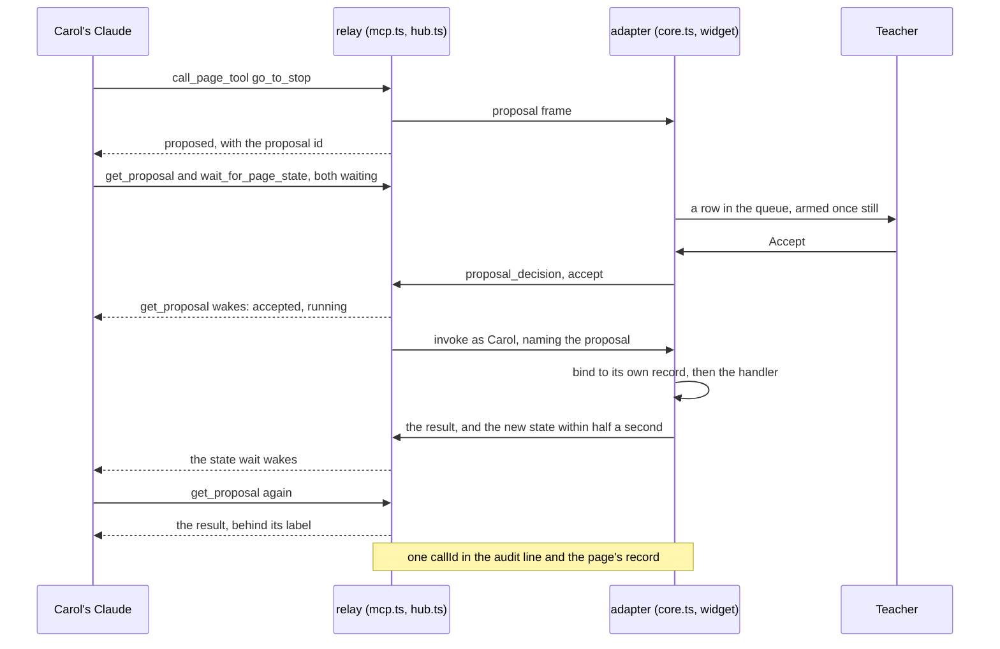

# 06: A class on one tab

M6 lets a room drive, follow and review a projected map. A map and globe profile runs on the sim page and the canvas page in `tests/map-page` (ADR 0038, the guide's [page 16](../guide/16-map-pages.md)); an image tool returns one checked picture behind its label (ADR 0039); clients read and wait on page state (ADR 0040); and `pnpm ci-check` walks a page from CI with no secret (ADR 0041). Observers propose writes the teacher accepts (ADR 0042); a members file reloads without a restart, and a time-boxed session narrows the policy and ends what it let in (ADR 0043); forty watchers sit apart from the members' seats, and an agent token lets an unattended client watch one page (ADR 0044). The teacher saves a record that `audit --match` holds to the log (ADR 0045), and a graceful restart can resume from a snapshot (ADR 0046).

Underneath, the MCP-B leg runs exact 6.0.0, where a page calls `installWebMCP()` (ADR 0047); the script-tag build may reach 200,000 bytes (ADR 0048); and `@tabdock/adapter/testing` clicks the widget for a CI check. Guide pages [17](../guide/17-check-from-ci.md), [18](../guide/18-images-and-state.md), [19](../guide/19-lessons-and-reviews.md), [20](../guide/20-larger-rooms.md), [21](../guide/21-run-a-class.md) and [22](../guide/22-join-a-shared-page.md) cover each part.

## One proposal, traced

Carol joined by a Can watch link, so her Claude is an invited observer on a map under `proposals: 'all'`; she asks it for the maria walkthrough's first stop.

1. `#call` in [hub.ts](../../packages/relay/src/hub.ts) finds Carol an observer on a page taking her proposals, so it calls `#propose`, and `callResult` in [mcp.ts](../../packages/relay/src/mcp.ts) answers `proposed` with an id.
2. `#propose` checks the arguments and the caps (three pending per user, twenty per page) and sends a proposal frame, never an invoke; `callPageTool` then logs a call line, outcome `proposed`, with no callId.
3. `onProposal` in [core.ts](../../packages/adapter/src/core.ts) asks `proposalsAdmit` and the page's own tools again and keeps a record of caller, tool and canonical arguments.
4. Accept (`acceptProposal`) sends `proposal_decision`; the record waits sixty seconds for its run.
5. `#proposalDecision` hands it to `#runAccepted`, which queues the call.
6. `onInvoke` calls `bindProposal`, which spends the record only for that caller, tool and arguments, in time; `check()` refuses an invoke naming a proposal it did not bind. The Accept was the confirmation (S5, S6).
7. `goToStop` in [world.ts](../../packages/sim-page/src/map/world.ts) moves the view, and the page hands the new state to `publishState`, which may hold it up to `STATE_MIN_INTERVAL_MS`.
8. `PageStates` in [page-state.ts](../../packages/relay/src/page-state.ts) stores it and `#wake` answers Carol's wait; her `get_proposal` woke at the Accept, and a second read returns the result behind its label.
9. `#callRecord` writes the run's line as Carol's, marked `acceptedOnPage`, with its callId and proposal id.
10. `recorder.call(entry, pageId)` in [record.ts](../../packages/adapter/src/record.ts) keeps that callId in the page's record, never arguments or results; `audit --match` pairs the two.

## Try it by hand

`pnpm demo:m6` runs this and nine more legs. By hand, a proposal needs the demo board with `&proposals=members` and a second dev-token user, set up as [tour 02](02-many-clients.md) does.

1. Run `pnpm relay` and paste its `claude mcp add-json` line; run `pnpm dev:map`, open `http://127.0.0.1:5174/`, check the relay URL and click Connect. Pair Claude Code, allow it, and ask it to read the guide's page 16 (`docs/guide/16-map-pages.md`) and walk the flyby, waiting on the state between stops.
2. In the widget, click Start a session, give it a label and 30 minutes, and Start; watch the countdown, then End session and End now. In local mode a session is a time box alone; once Claude has called during it, its end offers its record.
3. Click Save record, then Save JSON once it holds still, and run `pnpm audit:log --match <file> --verify` on the download; change one call's tool name in a copy and run it again to see a `FAIL` line.
